# 诡秘神谕 · LokiMetris

**移动展示终端：[LokiMetisMobileDisplay](https://github.com/ManonLoki/LokiMetisMobileDisplay)** —— 在 Android、iPhone、iPad、Apple Watch 和小组件上查看电脑数据。

LokiMetris 是面向 Windows、macOS 与 Linux 的原生桌面应用，用来查看 AI 编程工具的 Token 用量、账户额度与 Agent 活动。它把用量看板、Hooks 监控、桌宠、应用换肤和移动设备联动放在一起，使用 Rust 与 GPUI 构建，无需 WebView。

[下载桌面版](https://github.com/ManonLoki/LokiMetis/releases/latest) · [查看版本更新](https://github.com/ManonLoki/LokiMetis/releases)

[主要界面展示](#主要界面展示) · [下载与安装](#下载与安装) · [详细使用教程](#详细使用教程) · [数据存放](#数据存放) · [从源码运行](#从源码运行)

## 主要界面展示

以下均为 **2026-10-22 在 macOS 上运行 v0.9.0 的真实截图**，主窗口使用深色主题。用量、额度与设备状态是拍摄时的实际结果，会随使用变化；其他平台的窗口外观可能不同。点击图片可查看原图。

### 用量看板

切换工具和时间范围，查看调用数、Token 构成、缓存比例，以及来源数据的覆盖情况。

[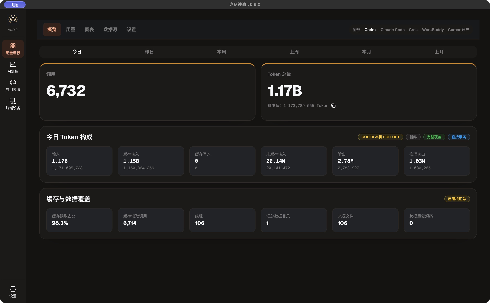](docs/images/ui/dashboard-overview.jpg)

### 趋势图表

按时间观察 Token 与调用趋势，选择分组维度和需要显示的指标。

[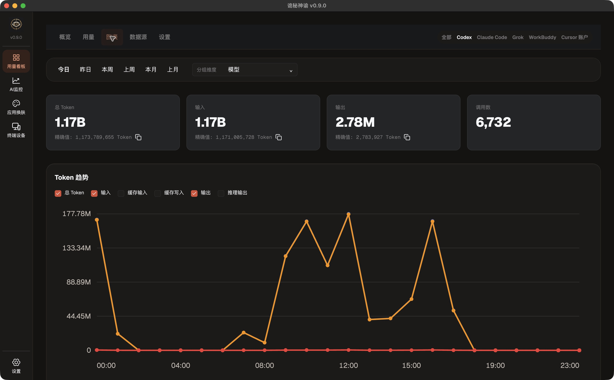](docs/images/ui/dashboard-charts.jpg)

### AI 监控与账户额度

工作台集中显示本机 Hook 中继、事件接收情况，以及当前可读取的提供商额度。

[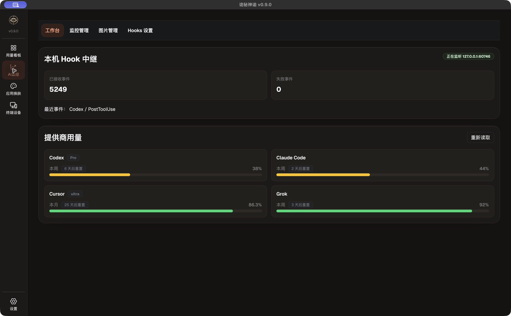](docs/images/ui/monitor-workbench.jpg)

### 应用换肤

为 Codex 或 WorkBuddy 浏览、搜索和应用皮肤，也可以导入资源包或创建自己的主题。

[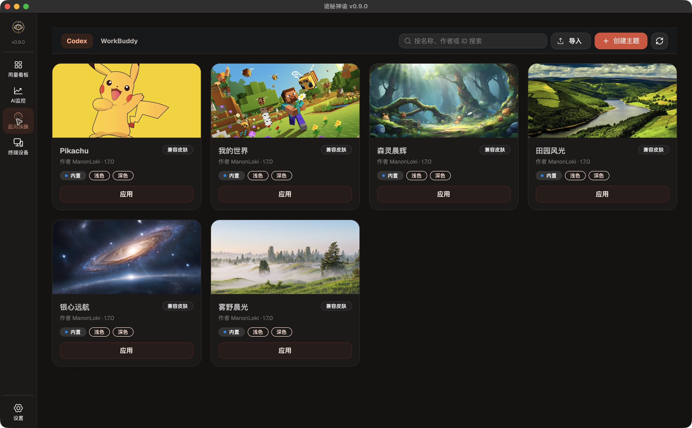](docs/images/ui/skins-gallery.jpg)

### 终端设备

查看已配对的手机和平板、在线状态、版本与最近通信时间。首次配对从移动端发起。

[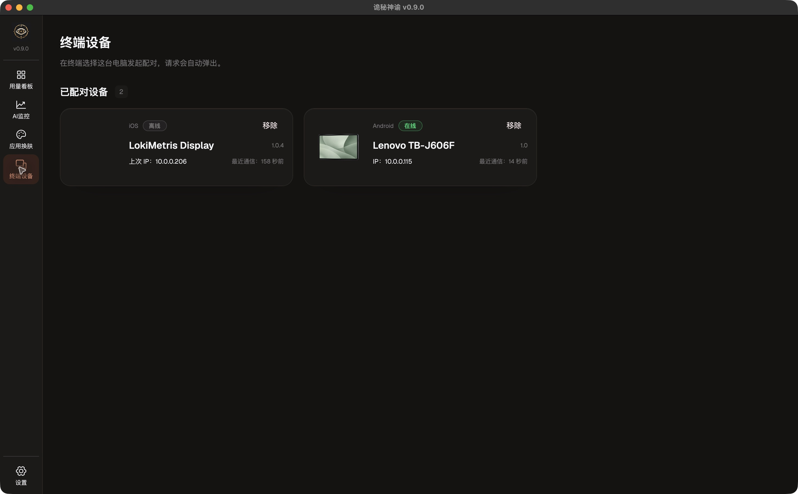](docs/images/ui/devices.jpg)

### 桌宠悬浮窗

将 Agent 状态图片和今日 Token 摘要留在桌面上；底部按钮可切换展示页。

[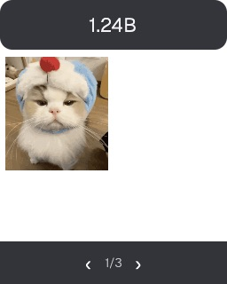](docs/images/ui/pet-overlay.jpg)

## 功能

### 用量看板与账户额度

| 工具 | 用量来源 | 账户额度 | 应用换肤 |
| --- | --- | --- | --- |
| Codex | 本机会话记录 | 支持 | macOS / Windows |
| Claude Code | 本机会话记录 | 读取本地 statusline 额度记录 | — |
| Cursor | 官方账户用量接口 | 支持 | — |
| Grok | 本机会话记录 | 支持 | — |
| WorkBuddy | 本机项目会话与 Trace 记录 | — | macOS / Windows |

- **六种时间范围**：今日、昨日、本周、上周、本月、上月。
- **Token 明细**：总量、输入、输出、缓存读写、推理输出与缓存比例；可复制精确数值。上游没有提供的分项显示为“未提供”。
- **统计与图表**：查看每日趋势，按模型、项目、会话、数据根分组；Codex、Claude Code 还可按推理强度查看。
- **调用记录**：在“全部”中按模型、推理强度、项目、会话、数据根筛选，支持排序和分页加载。
- **来源管理**：自动发现本地来源，也可手动添加目录、启停来源或设置别名；同时显示数据新鲜度、完整性与可信度。WorkBuddy 读取固定的 `~/.workbuddy`、`~/.workbuddy-ai` 项目目录。
- **WorkBuddy 专项统计**：会话与请求、Token 与积分、子代理请求，以及 Trace 错误率、取消数和平均时长。
- **账户额度**：按来源提供的周期显示剩余比例、套餐与重置时间，包括可用的五小时、周或账单月额度。

本机 Token 总量汇总 Codex、Claude Code、Grok 与 WorkBuddy。**Cursor 使用独立的账户用量视图，不并入本机总量**；查询使用电脑上已有的 Cursor 登录态，需要本机可用的 `curl` 与 `sqlite3`。

额度信息依赖对应工具的本地记录或现有登录态。Codex、Cursor、Grok 在需要时查询官方接口；Claude Code 读取本地 statusline 的 `rate_limits`。来源没有提供额度时不显示对应卡片。

### Hooks 监控与桌宠

支持 **Codex、Claude Code、Cursor、Grok、WorkBuddy** 的 Hooks 接入，展示空闲、运行中、询问、出错四种状态。

- 为每个 Agent 选择一个展示位（1～12 号），分别配置四种状态的文字和图片。
- 图库支持 JPEG、PNG、GIF、BMP、WebP 的导入、预览、筛选与删除，支持 GIF、APNG、动态 WebP 动画。
- 独立桌宠浮窗显示 Hooks 图文和今日 Token 摘要，支持翻页，以及 1×1、1×2、2×1、1×3、3×1、2×2 六种布局。
- 桌宠可调整尺寸、置顶、锁定位置与尺寸、开启鼠标穿透，并保存布局与位置。
- 系统通知可提示用量里程碑、Agent 询问、错误、完成，以及换肤结果。

### 应用换肤

在 macOS、Windows 上为 **Codex 与 WorkBuddy** 应用皮肤。

- 六套内置皮肤：我的世界、雾野晨光、森灵晨辉、Pikachu、田园风光、银心远航。
- 浏览、搜索与预览皮肤，创建用户主题。
- 导入前检查 ZIP 内容，导入皮肤或导出用户资源包。
- 切换 Codex 或 WorkBuddy，应用或停用皮肤；支持将旧皮肤转换为纯主题。

内置皮肤保留在应用中，不能删除或导出。Linux 当前不支持 Codex 与 WorkBuddy 换肤。

### 移动设备联动

配合 [LokiMetisMobileDisplay](https://github.com/ManonLoki/LokiMetisMobileDisplay)，在手机、平板、Apple Watch 和小组件上查看当日 Token、账户额度与 Hooks 状态。手机和平板还可同步状态文字与图片。

- 同一局域网内自动发现电脑，首次使用四位码配对，之后自动认证重连。
- 已配对设备页显示设备名称、平台、版本、在线状态与最近通信时间；移除设备会撤销本机配对并断开连接。
- Apple Watch 通过已配对的 iPhone 完成联动，桌面可查看对应 Watch 的在线与同步状态。
- 小组件使用独立只读权限获取用量、额度与活动摘要，后台更新受移动系统调度影响。

移动端的安装、设备要求、小组件与 Android 悬浮窗说明见[移动展示终端 README](https://github.com/ManonLoki/LokiMetisMobileDisplay#readme)。

### 日常设置

支持简体中文与 English、浅色/深色/跟随系统主题、Agent 显示开关、系统通知、开机自启，以及托盘中的主窗口和桌宠控制。用量扫描间隔可设为 1～1440 分钟，派生统计保留时间可设为 1～3650 天，默认分别为 5 分钟和 90 天。

## 下载与安装

从 [GitHub Releases](https://github.com/ManonLoki/LokiMetis/releases/latest) 下载对应平台的安装包：

| 平台 | 架构 | 格式 |
| --- | --- | --- |
| Windows | x64 | `.exe` 安装程序 |
| macOS | Apple Silicon（ARM64） | `.dmg` |
| Linux | AMD64 / ARM64（GNU） | `.deb`、`.tar.gz` |

Linux 的运行库要求以安装包声明为准；桌宠需要 X11 / XWayland，纯 Wayland 当前不支持桌宠所需的全局定位与置顶。托盘显示取决于桌面环境是否提供 StatusNotifierItem 支持。

## 详细使用教程

第一次使用可按 **启用工具 → 确认数据源 → 查看用量** 完成配置；需要活动提醒时，再接入 Hooks、配置图文并打开桌宠。换肤和移动设备联动按需使用。

[1. 启用工具](#guide-agents) · [2. 配置数据源](#guide-sources) · [3. 查看用量](#guide-usage) · [4. Cursor 账户](#guide-cursor) · [5. 查看额度](#guide-quota) · [6. 接入 Hooks](#guide-hooks) · [7. 配置状态图文](#guide-profiles) · [8. 使用桌宠](#guide-pet) · [9. 应用皮肤](#guide-skins) · [10. 连接移动设备](#guide-devices)

<a id="guide-agents"></a>

### 1. 启用需要的工具

1. 点击左下角 **设置**。
2. 在 **启用的 Agent** 中勾选要使用的工具，等待设置保存。这里是看板、监控与换肤共用的全局选择。
3. 按习惯选择 **中文 / English** 和 **浅色 / 深色 / 跟随系统**。
4. 按需开启 **系统通知** 和 **开机自启**；点击“系统通知”旁的展开按钮，可查看触发规则、系统权限与发送状态。

<details>
<summary>查看设置界面截图</summary>

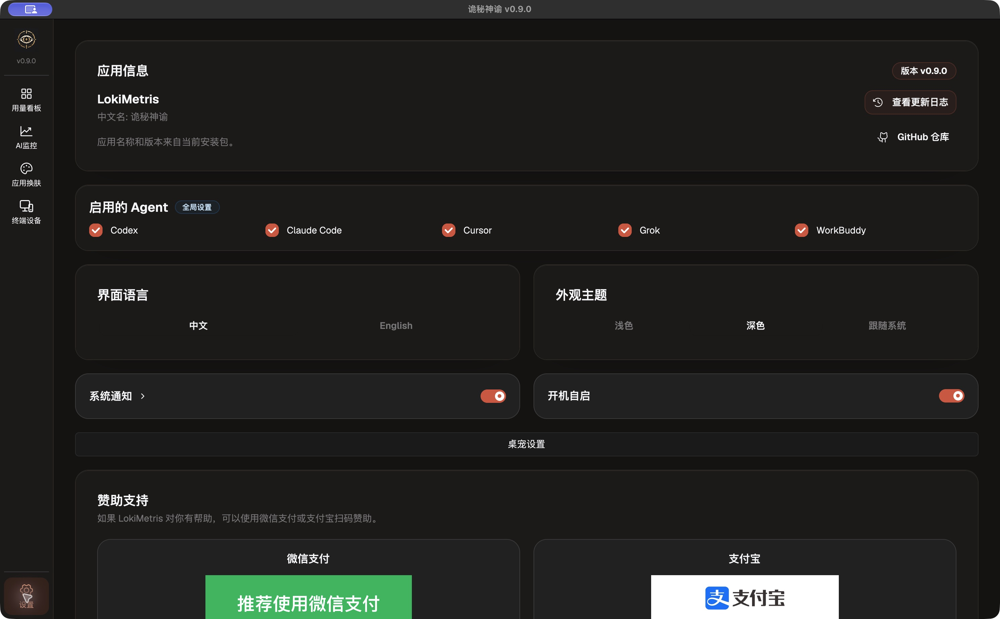

</details>

<a id="guide-sources"></a>

### 2. 确认数据源与扫描设置

1. 打开 **用量看板**，在右上角选择 Codex、Claude Code、Grok 或 WorkBuddy，再进入顶部 **数据源**。
2. 检查自动发现的目录是否处于 **已启用** 状态。没有找到预期目录时，先点 **快速扫描**；需要扩大查找范围时，再使用 **全盘扫描**。
3. 会话放在自定义位置时，点 **添加数据目录** 选择对应工具的数据根目录。WorkBuddy 使用固定项目目录，不提供此按钮。
4. 需要重建某个目录的统计时，使用该行的 **重新索引**；**重命名** 可设置易识别的别名，**停用** 可将该来源排除在统计之外。
5. 切到看板内的 **设置**，调整扫描间隔与自动清理天数，并分别点击 **保存扫描间隔**、**保存自动清理天数**。各工具页面共用这一组参数。

默认每 5 分钟扫描，保留 90 天派生统计。扫描间隔支持 1～1440 分钟，保留时间支持 1～3650 天；自动清理在下次启动时执行。自动清理和“移除索引”针对 LokiMetris 的派生数据，不删除原始 Agent 会话文件。首次读取尚未结束时，零值不代表没有历史用量。

<details>
<summary>查看数据源与扫描设置截图</summary>

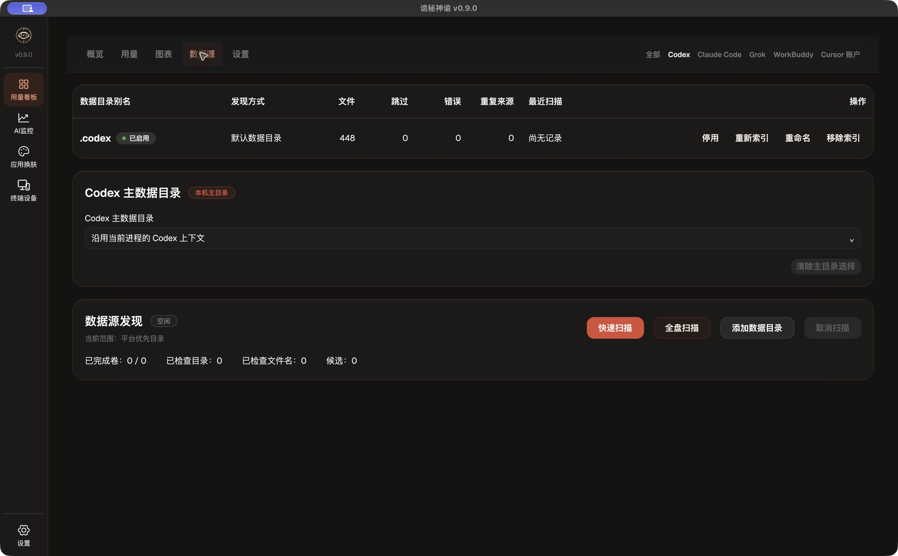

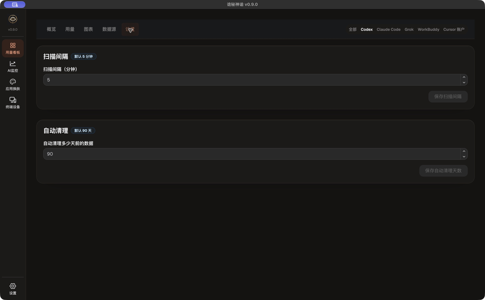

</details>

<a id="guide-usage"></a>

### 3. 查看总量、分组与调用记录

1. 在 **用量看板** 右上选择工具，再选 **今日、昨日、本周、上周、本月、上月**。
2. **概览** 查看总量与 Token 构成；点击数值旁的复制图标，可复制精确数值。
3. **用量** 通过 **分组维度** 查看模型、项目、线程或数据目录的贡献；Codex、Claude Code 还支持推理强度。
4. **图表** 查看时间趋势，通过指标开关选择总 Token、输入、输出或缓存等曲线。
5. 需要逐条追踪时，把右上工具切换为 **全部**，再进入 **调用**。可按模型、推理强度、项目、线程、数据目录筛选，点击表头排序，用 **加载更多** 继续查看；**清除筛选** 恢复查询范围。

图表和卡片旁的数据来源、覆盖与可信度标签用于判断统计是否完整。上游未提供的分项显示 **未提供**，应与真实的 `0` 区分。界面示例见上方[用量看板与趋势图表](#主要界面展示)。

<a id="guide-cursor"></a>

### 4. 查看 Cursor 账户用量

1. 先在本机 Cursor 中登录账户，再回到 **用量看板 → Cursor 账户**。
2. 选择时间范围，查看输入、输出、缓存读取和缓存写入，以及按日期、模型汇总的结果。
3. 同时查看 **已上报记录** 的覆盖数；覆盖不足时，当前合计只代表接口已返回的部分。

此视图读取独立的官方账户用量，不并入本机 Token 总量；依赖本机已有的 Cursor 登录态与可用的 `curl`、`sqlite3`。缺失字段不按零处理，缓存读写也不与输入字段重复相加。

<details>
<summary>查看 Cursor 账户用量截图</summary>

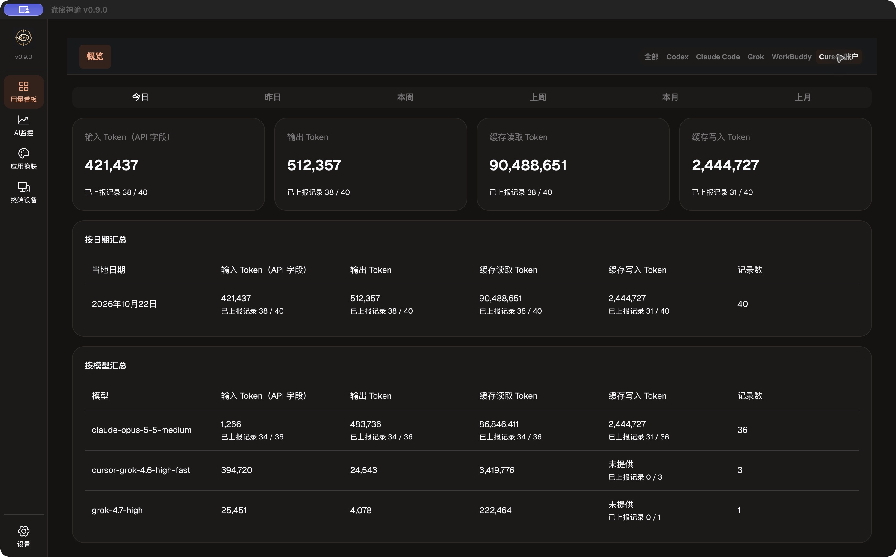

</details>

<a id="guide-quota"></a>

### 5. 查看账户剩余额度

1. 打开 **AI监控 → 工作台**，查看 **提供商用量** 区域。
2. 按卡片读取套餐、可用的周期、剩余比例与重置时间；需要更新时点击 **重新读取**。
3. 没有出现某个工具的卡片时，先确认对应工具有可读取的本地记录或有效登录态，再重新读取。

Codex、Cursor、Grok 在需要时查询官方接口，Claude Code 读取本地 statusline 的 `rate_limits`。周期随来源变化，不保证每个工具都同时提供五小时、周和月额度。实际卡片示例见上方[AI 监控与账户额度](#ai-监控与账户额度)。

<a id="guide-hooks"></a>

### 6. 接入工具的 Hooks

1. 打开 **AI监控 → Hooks 设置**，选择要接入的 Agent。
2. 核对 **配置目录** 与只读的 **配置文件** 路径。使用自定义目录时，点 **选择目录**，再点 **保存路径**；有未保存的路径修改时，不能写入 Hooks。
3. 确认路径属于目标工具后，点 **写入 Hooks**，按返回提示完成宿主审核、重启或新建会话等后续步骤。
4. 在目标工具中进行一次实际交互，再回到 **工作台** 查看 **已接收事件** 和 **最近事件** 是否更新。

写入 Hooks 会修改所选工具的配置。Codex、WorkBuddy 等宿主可能还需要审核接入，不能只根据写入成功判断事件已开始上报。协议与兼容细节见 [Hooks 协议](docs/HOOKS_PROTOCOLS.md)。

<details>
<summary>查看 Hooks 设置截图</summary>

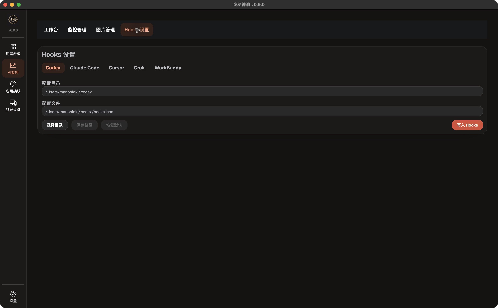

</details>

<a id="guide-profiles"></a>

### 7. 配置状态图片与文字

1. 打开 **AI监控 → 图片管理**，用 **批量上传** 导入自己的图片；可以按 JPEG、PNG、GIF、BMP、WebP 分类浏览。
2. 进入 **监控管理**，选择 Agent，再从 1～12 号中选择它的 **显示位置**。
3. 按需为 **空闲、运行中、询问、异常** 四种状态选择图片。点击图片区域的 **更换图片** 可从图库选择，也可在选择器中 **直接上传**；“内容”是可选的补充文字。
4. 向下滚动查看其余状态，配置完成后点击底部 **保存展示配置**。需要区分多个 Agent 时，为它们安排不同位置。

GIF、APNG、动态 WebP 可用于动画展示。正在被展示配置引用的图片不能直接删除，需先更换引用。配置后的效果可在桌宠和已连接的手机、平板上查看。

<details>
<summary>查看显示位置与状态图文配置截图</summary>

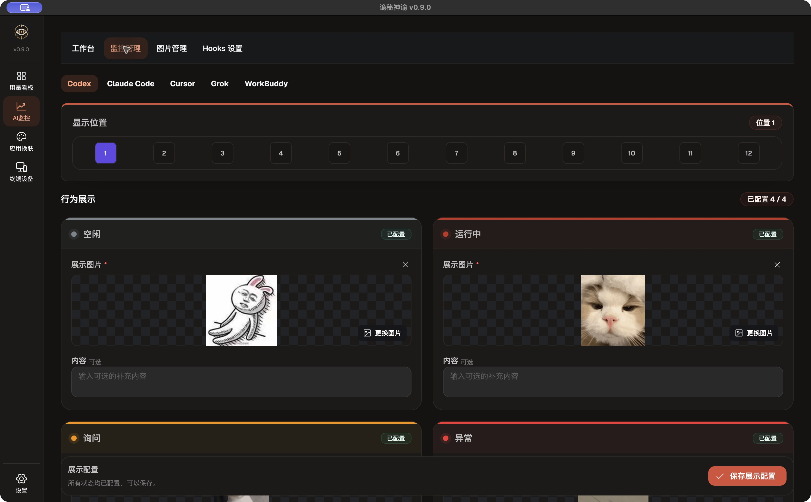

</details>

<a id="guide-pet"></a>

### 8. 打开并调整桌宠

1. 在系统托盘菜单选择 **显示浮窗**，打开桌宠。
2. 在浮窗任意位置点击鼠标右键，或从主窗口 **设置 → 桌宠设置** 打开设置。
3. 选择 **1×1、1×2、2×1、1×3、3×1、2×2** 布局，调整 **桌宠大小**；使用浮窗底部的上一页、下一页查看其余位置。
4. 按需设置 **始终置顶**、**锁定位置和大小**、**鼠标穿透**。开启穿透后浮窗不接收鼠标，可从系统托盘或主窗口的桌宠设置恢复。

“返回主界面”可恢复主窗口；“隐藏到系统托盘”可收起浮窗。Linux 桌宠需要 X11 / XWayland，纯 Wayland 当前不支持。

<details>
<summary>查看桌宠设置截图</summary>

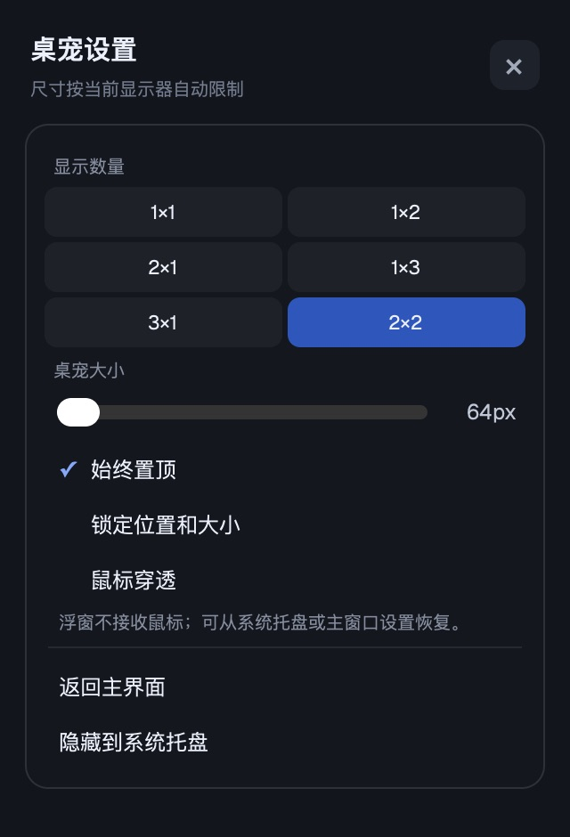

</details>

<a id="guide-skins"></a>

### 9. 为 Codex 或 WorkBuddy 应用皮肤

1. 在 macOS 或 Windows 打开 **应用换肤**，在顶部选择 **Codex** 或 **WorkBuddy**。
2. 浏览内置皮肤，或按名称、作者、ID 搜索；点击目标皮肤卡片的 **应用**。
3. 按实际反馈处理宿主状态：如果检测到多个实例，先关闭多余实例后刷新；缺少所需调试连接时，会弹出重启确认。确认前先保存宿主中的工作。
4. 需要停用时，点击已生效皮肤卡片的 **停止**。
5. 自有皮肤使用顶部 **导入** 选择 ZIP，或通过 **创建主题** 新建；用户皮肤的 `···` 菜单可打开目录、导出 ZIP 或删除，兼容皮肤还可转换为纯主题。

界面示例见上方[应用换肤](#应用换肤)。内置皮肤不能删除或导出；Linux 当前不支持该换肤能力。这里改变的是所选宿主工具的外观，LokiMetris 自身的浅色、深色主题在 **设置** 中调整。

<a id="guide-devices"></a>

### 10. 连接手机、平板、Watch 与小组件

1. 安装 [LokiMetisMobileDisplay](https://github.com/ManonLoki/LokiMetisMobileDisplay)，让电脑与手机或平板连接同一局域网，保持桌面应用运行。
2. 在移动端设置中选择自动发现的电脑并发起配对，允许所需的本地网络访问。
3. 电脑会自动弹出配对窗口，输入 **移动端显示的四位码**，再点击 **配对**。
4. 在电脑 **终端设备** 页确认设备已列出，检查在线状态与最近通信时间；回到移动端展示台查看今日 Token、额度和 Hooks 状态。
5. 以后打开移动端会自动认证重连。Apple Watch 沿用已配对 iPhone 的连接；小组件的配置步骤见移动端 README，后台刷新频率由系统调度。

桌面的 **终端设备** 页用于查看已配对设备，不提供主动发起配对的按钮。移动端进入后台或断线时可能显示离线，重新打开后等待恢复；**移除** 会撤销该设备的本机配对并断开连接，下次需要重新配对。设备页示例见上方[终端设备](#终端设备)。

### 常见情况

| 情况 | 优先检查 |
| --- | --- |
| 看板没有预期工具 | 到左下角“设置 → 启用的 Agent”确认已勾选。 |
| 用量为零或缺少历史 | 确认工具、时间范围、数据源启用状态和扫描结果，等待首次读取完成；需要时添加目录或重新索引。 |
| 找不到“调用”页 | 把看板右上角的工具切换为“全部”。 |
| 额度卡片未出现 | 检查对应工具的本地额度记录或登录态，再到“AI监控 → 工作台”重新读取。 |
| Hooks 写入成功却没有事件 | 按宿主提示完成审核、重启或新建会话，再检查工作台的接收计数。 |
| 桌宠无法点击 | 检查是否开启鼠标穿透，从托盘或主窗口“桌宠设置”关闭。 |
| 手机找不到电脑 | 确认同一局域网、桌面应用运行、本地网络权限，以及防火墙允许局域网通信。 |

## 数据存放

Codex、Claude Code 与 Grok 的本机会话统计写入 LokiMetris 自己的派生索引；WorkBuddy 读取本机项目记录，Cursor 查询独立账户用量。统计保留时间只影响派生数据，不删除原始 Agent 会话文件。Hooks 接入会修改对应工具的配置；换肤会改变所选宿主实例的运行时外观。

业务数据默认目录：

| 平台 | 路径 |
| --- | --- |
| macOS | `~/Library/Application Support/app-loki-metris/data` |
| Windows | `%LOCALAPPDATA%/app-loki-metris/data` |
| Linux | `~/.local/share/app-loki-metris` |

账户用量与额度可能访问对应提供商的官方接口；移动展示通过配对后的局域网加密连接同步。应用字体随包内嵌。

## 从源码运行

需要 Rust ≥ 1.98.1、Node.js ≥ 24.21.0、pnpm ≥ 12.4.1，以及当前平台的原生编译工具。Linux 依赖与双架构构建说明见 [Linux GPUI 工程知识库](docs/LINUX_GPUI_TOOLCHAIN.md)。

```sh
git clone https://github.com/ManonLoki/LokiMetis.git
cd LokiMetis
pnpm run dev
```

`pnpm run dev` 会通过 Cargo 启动 GUI，并设置源码中的皮肤资源目录。Node.js/pnpm 仅用于工程脚本，根工程没有 npm 第三方依赖。

macOS 需要完整 App bundle 身份时，可运行 `pnpm run gpui:preview` 准备本地预览 App；该命令不会自动启动 App。

调试时可用绝对路径环境变量 `LOKI_METRIS_DATA_DIR` 指定业务数据目录。它不改变原始会话来源、GUI 偏好目录或系统集成设置。Bash 示例：

```sh
LOKI_METRIS_DATA_DIR="$PWD/target/dev-data" pnpm run dev
```

## 技术与目录

Rust 2024、GPUI / gpui-kit 原生界面，SeaORM + SQLite 存储派生数据，Tokio 运行后台服务，rust-i18n 提供中英界面。

```text
.
├── loki_metris_core/           # 业务规则、用量统计、监控与设备领域逻辑
├── loki_metris_gui/            # GPUI 界面、桌宠、原生系统集成与数据读取
├── loki_metris_pairing/        # 共享配对与加密协议
├── loki_metris_mobile_bridge/  # 移动端 JNI / C ABI 桥接
├── vendor/                    # 原生依赖兼容补丁
├── packaging/                 # 平台打包配置
├── scripts/                   # 开发与打包脚本
├── docs/                      # 技术与使用协议
└── Cargo.toml                 # 工作区、依赖与当前版本
```

## 项目架构

桌面端采用原生界面、后台服务与业务核心分层，移动端通过局域网读取桌面提供的数据。

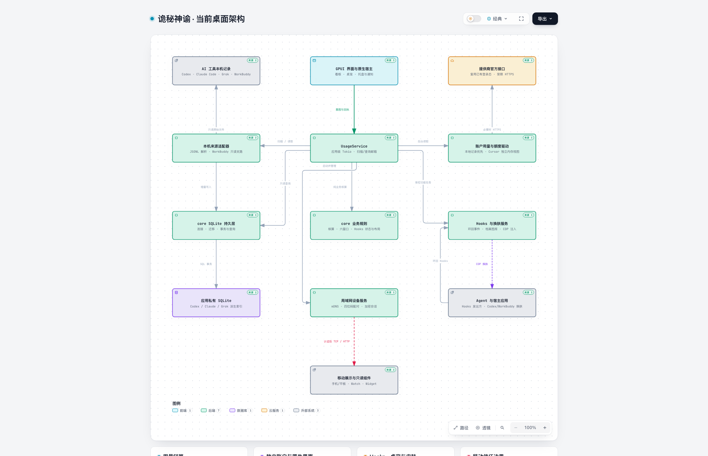

[查看大图](.archify/architecture-desktop-20261022-144530/visual-check/desktop.visual-check.2048x1320.light.png) · [Archify 交互图](.archify/architecture-desktop-20261022-144530/desktop.html) · [架构说明与源码位置](docs/ARCHITECTURE.md)

- **界面与后台**：GPUI 主线程负责看板、桌宠和原生交互；`UsageService` 通过后台任务与查询回执连接界面和数据驱动，磁盘与网络操作在后台执行。
- **业务与存储**：`loki_metris_core` 提供 Token 核算、时间窗口、Hooks 状态机、布局投影和 SQLite 持久层；GUI 中的来源适配器负责发现、读取与解析本机会话。
- **共享协议与移动联动**：`loki_metris_pairing` 提供共享配对与加密规则，`loki_metris_mobile_bridge` 编入移动 App。桌面设备服务负责发现、配对、图文推送及只读摘要，手机、Watch 与小组件按各自通道接收。

交互图可下载后在浏览器打开，节点附有对应源码位置。移动端的连接、缓存与平台模块关系见[移动架构说明](https://github.com/ManonLoki/LokiMetisMobileDisplay/blob/main/docs/07-当前架构.md)。

进一步阅读：[当前架构与 Archify 图](docs/ARCHITECTURE.md)、[技术选型与依赖](docs/TECHNOLOGY.md)、[Rust / GPUI 运行时与命令](docs/RUST_CLI_TEMPLATE.md)、[Hooks 协议](docs/HOOKS_PROTOCOLS.md)、[设备联动协议](docs/DEVICE_LINK_PROTOCOL.md)、[已知问题](docs/TECH_DEBT.md)。

## 许可

本项目使用企业专有商业许可证：[`LICENSE.zh-CN.md`](LICENSE.zh-CN.md) 与 [`LICENSE.en.md`](LICENSE.en.md)。字体许可与来源见 [`loki_metris_gui/assets/fonts/`](loki_metris_gui/assets/fonts/)，第三方许可不被本项目许可覆盖。

## 赞助

如果 LokiMetris 对你有帮助，可以使用微信支付或支付宝扫码赞助。

| 微信支付 | 支付宝 |
| --- | --- |
|  |  |
